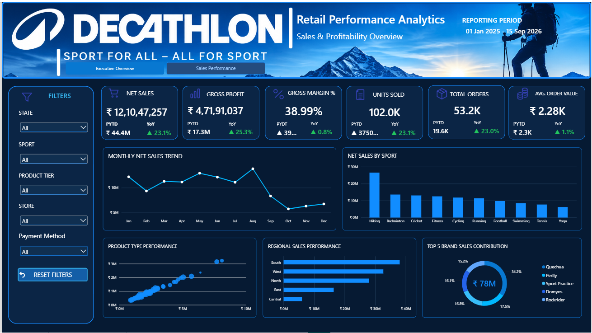
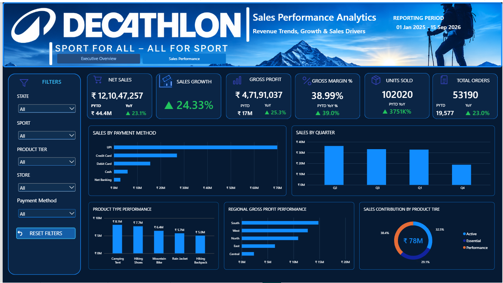
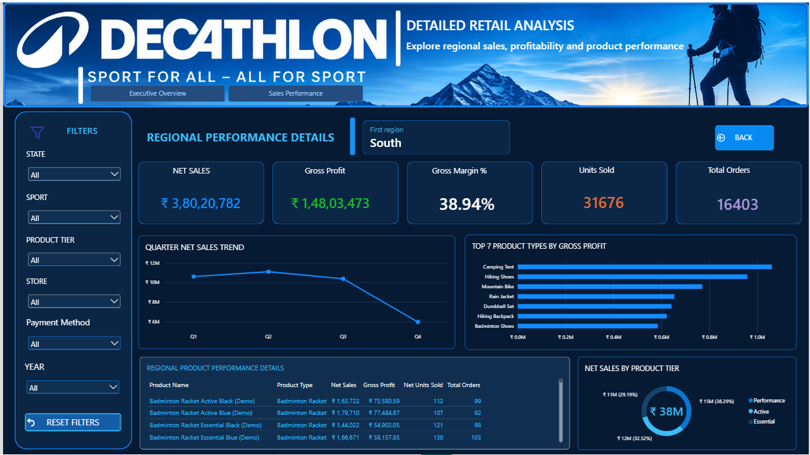
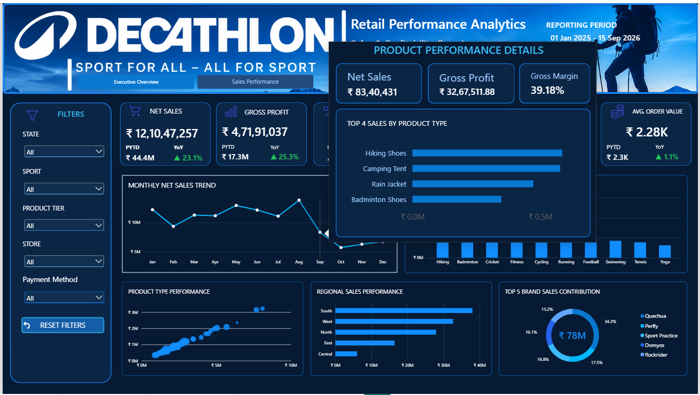

# Decathlon Retail Performance Analytics

**End-to-End Data Analytics | PostgreSQL | Python | Power BI**

An end-to-end retail analytics project focused on sales performance, profitability, product analysis, and regional business performance. The project transforms raw retail data into actionable insights through SQL analysis, Python data preparation, and interactive Power BI dashboards.

---

## Dashboard Preview

### Executive Overview
A high-level view of retail performance, including revenue, profitability, sales trends, and key business KPIs.



### Sales Performance
An interactive analysis of sales performance across time, regions, products, brands, and sports categories.



### Detailed Analysis – Drill Through
A detailed view that allows users to investigate business performance at a more granular level.



### Custom Tooltip – Executive Overview
Additional contextual information presented through interactive report tooltips.



---

## Business Objectives

- Monitor sales and profitability performance.
- Compare current-year results with the previous year.
- Evaluate regional and state-level performance.
- Identify high-performing and underperforming products.
- Analyze brand, category, and sports segment contributions.
- Identify opportunities to improve revenue and profitability.

## Technology Stack

| Tool | Purpose |
|---|---|
| PostgreSQL | Data storage, SQL analysis, and KPI validation |
| Python (Pandas) | Data inspection and cleaning |
| Power BI | Data modeling, DAX, and interactive dashboards |
| Excel | Source data and data review |

## Project Workflow

1. Business Understanding
2. Data Understanding
3. Data Cleaning and Preparation
4. PostgreSQL Database Setup and Validation
5. SQL Business Analysis
6. Power BI Data Modeling and DAX
7. Interactive Dashboard Development
8. Business Insights and Recommendations

## Key Business Insights

The analysis focuses on:

- Year-over-year sales and profit performance.
- Regional and state-level business contribution.
- Product and brand performance comparisons.
- Profitability across different sports and product segments.
- Business opportunities for improving sales and margins.

For detailed findings and actionable recommendations, see:

[06 – Business Insights & Recommendations](Documentation/06_Business_Insights_Recommendations.md)

## Key Performance Indicators

The Power BI dashboard tracks six core business KPIs:

| KPI | Business Purpose |
|---|---|
| Net Sales | Measure overall sales performance |
| Gross Profit | Evaluate business profitability |
| Gross Margin % | Monitor profitability efficiency |
| Total Orders | Track order volume |
| Units Sold | Measure product sales volume |
| Average Order Value | Evaluate average revenue per order |

## Project Documentation

| Document | Description |
|---|---|
| [01 – Business Understanding](Documentation/01_Business_Understanding.md) | Business requirements and objectives |
| [02 – Data Understanding](Documentation/02_Data_Understanding.md) | Dataset exploration and quality assessment |
| [03 – Data Model](Documentation/03_Data_Model_Documentation.md) | Data model and relationships |
| [04 – KPI & DAX](Documentation/04_KPI_DAX_Documentation.md) | KPI definitions and DAX measures |
| [05 – Dashboard Documentation](Documentation/05_Dashboard_Documentation.md) | Dashboard pages and functionality |
| [06 – Business Insights](Documentation/06_Business_Insights_Recommendations.md) | Findings and recommendations |

## Repository Structure

```text
Decathlon_Retail_Performance_Analytics/
│
├── Data/
│   ├── Raw/
│   └── Processed/
│
├── Documentation/
│   ├── 01_Business_Understanding.md
│   ├── 02_Data_Understanding.md
│   ├── 03_Data_Model_Documentation.md
│   ├── 04_KPI_DAX_Documentation.md
│   ├── 05_Dashboard_Documentation.md
│   └── 06_Business_Insights_Recommendations.md
│
├── PostgreSQL/
│   └── SQL_Scripts/
│
├── PowerBI/
│   ├── Decathlon_Retail_Performance_Analytics_Dashboard.pbix
│   ├── Backgrounds_icons/
│   └── Dashboard_Screenshots/
│
├── Python/
│   └── Notebooks/
│
├── .gitignore
└── README.md
```

## Project Deliverables

- Interactive Power BI dashboard (`.pbix`)
- PostgreSQL database and SQL analysis scripts
- Python data inspection and cleaning notebooks
- Raw and processed datasets
- Complete project documentation
- Business insights and recommendations

---

**Project:** Decathlon Retail Performance Analytics  
**Focus:** Retail Business Intelligence & Data Analytics  
**Tools:** PostgreSQL | Python | Power BI | Excel